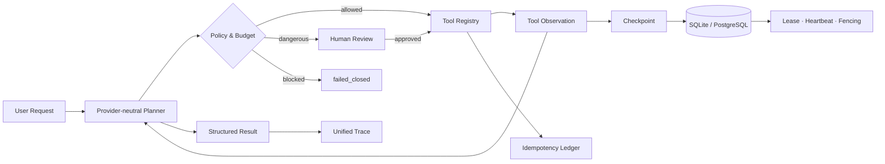

# AI Agent Runtime — 智能任务编排与工具执行引擎

[](https://github.com/KristenYue/agent-runtime-quality-platform/actions/workflows/ci.yml)

## Project Overview

为工具型 AI 应用提供可复用的执行内核。业务项目只需要实现 Planner 和工具，本 Runtime 负责把模型动作转换为受控执行，保存任务上下文与工具结果，并支持人工确认、Checkpoint、恢复和统一 Trace。

它解决的是 AI 产品中的长任务问题：模型已经决定“下一步做什么”之后，系统如何安全调用工具、记录进度、处理中断，并避免旧 Worker 或重复提交覆盖正确结果。

## Application Scenarios

| 场景 | Runtime 提供的能力 |
|---|---|
| 工业设备诊断 | 执行设备状态和 Runbook 工具，保存真实 LLM 的多轮规划上下文 |
| ROS 2 机器人技能 | 封装 Action 工具，记录进度、取消和最终结果 |
| NLP / RAG Agent | 保存检索、Reviewer、人工复核和最终标签的状态迁移 |
| 异步业务任务 | Worker 中断后由 Checkpoint、Lease 和 Fencing 支持安全接管 |

## Features & Real Demonstration

### Planner → Tool → Observation → Result

```python
class Planner:
    async def decide(self, *, request, observations, step):
        if not observations:
            return {
                "kind": "tool",
                "tool": {"tool_name": "read_equipment_snapshot", "arguments": {}},
            }
        return {"kind": "finish", "result": {"status": "completed"}}
```

工具通过显式注册表接入：

```python
registry = ToolRegistry([
    ToolSpec("read_equipment_snapshot", read_snapshot, permission="read"),
    ToolSpec("start_device", start_device, permission="dangerous"),
])
```

Runtime 对每次执行生成：

- Run / Step / ToolCall / Error 统一结构；
- 工具参数、结果、耗时与幂等键；
- `running`、`waiting_review`、`completed`、`failed_closed` 状态；
- 可恢复的 Checkpoint 与人工确认上下文。

真实业务示例：[Industrial AI Agent](https://github.com/KristenYue/telecom-network-incident-agent)使用本 Runtime 执行 3 轮真实模型规划和 2 次设备/知识工具调用；ROS 2 扩展将仿真巡检 Action 注册为 Runtime 工具。

## System Architecture



## Core Implementation

| 模块 | 作用 |
|---|---|
| Planner Protocol | 与具体模型供应商解耦，接收 request、observations 和 step，返回结构化动作 |
| Tool Registry | 同步/异步工具、权限等级、上下文注入、白名单和危险操作确认 |
| Execution Loop | 步骤预算、工具预算、批量并发调用、失败关闭和最终结果提交 |
| Task Context | 保存观测、步骤、错误、待审批动作和工具调用数量 |
| Checkpoint Backend | SQLite 本地开发；PostgreSQL 业务部署路径 |
| Recovery | Lease、Heartbeat、单调 Fencing Token、缓存工具结果和安全重放判断 |
| Trace | Run、Step、ToolCall 与 Error 的统一数据契约 |
| Quality Gate | 可选的 baseline/candidate 成对回归接口，不与 Runtime 核心职责耦合 |

Lease 与 Fencing 不是为了强调数据库技巧，而是为了保证 AI 长任务在 Worker 崩溃、超时或接管时仍能维持单一有效执行权。幂等账本用于复用已完成的工具结果；对状态未知的非 replay-safe 写操作，Runtime 会失败关闭而不是盲目重放。

## Engineering Results

| 工程结果 | 说明 |
|---|---|
| Provider-neutral Planner + Tool Registry | 同一执行内核可服务工业诊断、ROS 2 与 NLP/RAG 业务 |
| SQLite / PostgreSQL 双后端 | 本地快速运行与真实数据库接管路径分离 |
| 人工确认与恢复 | 高风险动作暂停，审批后继续原任务上下文 |
| Fenced state writes | 失租旧 Worker 不能覆盖新 Worker 的 Checkpoint 或工具结果 |
| Deterministic idempotency key | 已完成工具在恢复时从账本回放，不重复执行 |
| 统一 Trace | 业务层可以解释模型选择了什么工具、工具返回什么以及任务为何结束 |

## Industry Applications

- **半导体与 AI 芯片：** 研发 Agent、设备诊断、长时间分析任务和受控研发工具调用。
- **智能汽车：** 车端/云端 Agent 的任务状态、工具执行、人工确认与恢复基础设施。
- **具身智能：** 机器人技能注册、任务编排、Action 进度、取消和结果提交。

这些是 Runtime 的可迁移应用方向；仓库本身不宣称已部署到真实产线、量产车辆或机器人真机。

## Quick Start

```powershell
python -m venv .venv
.\.venv\Scripts\python.exe -m pip install -e ".[dev]"
.\.venv\Scripts\python.exe -m pytest -q --basetemp .pytest-tmp
.\.venv\Scripts\python.exe scripts\run_acceptance_benchmark.py
```

PostgreSQL 路径需要安装 `.[dev,postgres]` 并设置 `RUNTIME_DATABASE_URL`；GitHub Actions 使用 PostgreSQL 16 验证双 Worker 接管。

## Evidence & Source Code

| 内容 | 入口 |
|---|---|
| Runtime 主循环 | [runtime.py](src/agent_runtime_platform/runtime.py) |
| Planner、动作与 Trace 契约 | [contracts.py](src/agent_runtime_platform/contracts.py) |
| 工具注册与权限 | [tools.py](src/agent_runtime_platform/tools.py) |
| PostgreSQL Backend | [postgres.py](src/agent_runtime_platform/postgres.py) · [设计文档](docs/POSTGRES_BACKEND.md) |
| 架构与所有权边界 | [ARCHITECTURE.md](docs/ARCHITECTURE.md) · [ADR-0001](docs/adr/0001-v2-runtime-integration-boundary.md) |
| 工业业务接入 | [Industrial AI Agent](https://github.com/KristenYue/telecom-network-incident-agent) |
| 逐 case 验收报告 | [acceptance report](data/evaluation/acceptance_v1/report.json) |

## Validation & Limitations

- 冻结验收包含 180 条功能任务、70 次故障处置和 60 组重复提交；这些数字验证当前契约，不代表生产 SLA。
- PostgreSQL 测试验证 Lease 接管和陈旧 Fencing 写入拒绝，不是长期容量或高并发压测。
- 幂等键与工具账本只覆盖已登记的调用，不能对任意外部系统提供 exactly-once 保证。
- SQLite 用于本地开发，不承担多 Worker 生产协调。
- 对无法确认是否已经产生副作用的写工具，恢复路径按设计失败关闭。

详细问题定位和回归证据见 [ENGINEERING_LOG.md](docs/ENGINEERING_LOG.md) 与 [SOURCE_BOUNDARY.md](docs/SOURCE_BOUNDARY.md)。

## License

[MIT](LICENSE)
