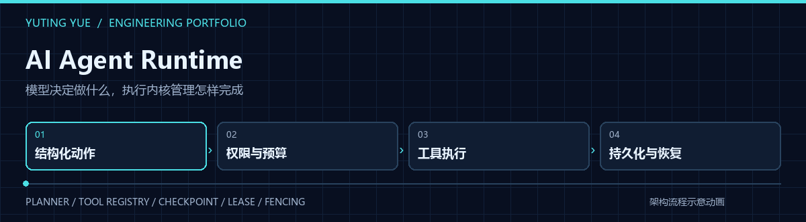
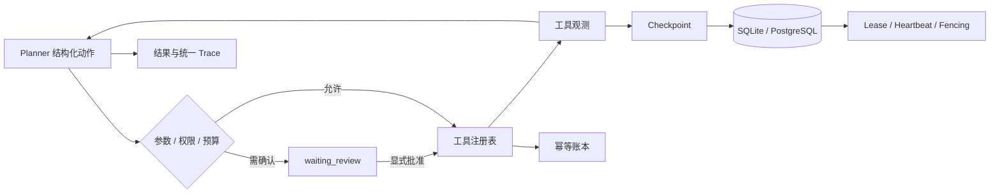

# AI Agent Runtime｜智能任务编排与工具执行引擎



<sub>架构流程示意动画 · [静态版本](docs/assets/overview.png) · 动画不作为实测结果。</sub>

[返回技术作品集](https://github.com/KristenYue/KristenYue) · [机器人业务](https://github.com/KristenYue/telecom-network-incident-agent/blob/main/docs/ROBOT_DELIVERY.md) · [原生模型 SDK](https://github.com/KristenYue/edge-device-verification-lab/tree/main/inference_sdk) · [车辆 Agent](https://github.com/KristenYue/telecom-network-incident-agent/blob/main/docs/VEHICLE_ADAPTER.md)


**Python · Planner Protocol · Tool Registry · Checkpoint · PostgreSQL · Lease / Fencing**

模型决定下一步动作后，仍需要一个软件内核负责**校验、执行、记录、审批和恢复**。本项目实现可复用 Runtime，业务项目只注入 Planner 与工具，不重复构建任务执行机制。

**阅读定位：** [机器人技能](https://github.com/KristenYue/telecom-network-incident-agent/blob/main/docs/ROBOT_DELIVERY.md)、[工业设备诊断](https://github.com/KristenYue/telecom-network-incident-agent)、[车辆服务](https://github.com/KristenYue/telecom-network-incident-agent/blob/main/docs/VEHICLE_ADAPTER.md)在业务仓库完成；本页看它们共用的执行机制。后端 / 任务平台岗位优先阅读本仓库。

## 架构：从动作到结果



## 三个有纵深的工程设计

| 工程问题 | 实现方式 | 为什么这样设计 |
|---|---|---|
| **模型可变，执行契约要稳定** | Provider-neutral Planner 接收 request / observations / step；输出 tool / finish 等结构化动作；工具显式注册并携带权限、上下文和 replay-safe 信息 | 业务和模型供应商更换时，执行状态、记录与审批语义保持一致。[契约](src/agent_runtime_platform/contracts.py) · [工具](src/agent_runtime_platform/tools.py) |
| **重复投递与中断后怎么继续** | 每步保存 Checkpoint，已完成工具结果写账本；恢复时判断是否能安全重放，对不确定写副作用失败关闭 | 不把“重新跑一遍”当作恢复，也不对外部系统承诺任意 exactly-once。[主循环](src/agent_runtime_platform/runtime.py) |
| **租约过期后旧 Worker 又恢复怎么办** | Lease / Heartbeat 检测失效，单调递增 Fencing Token 约束后续写入；PostgreSQL 拒绝旧代际更新 | 心跳只判断存活，Fencing 才能阻止过期执行者覆盖接管结果。[PostgreSQL](src/agent_runtime_platform/postgres.py) · [设计](docs/POSTGRES_BACKEND.md) |

## 量化结果与真实服务验收

| 验证对象 | 结果 | 证据与口径 |
|---|---|---|
| 任务契约 | **180 / 180** | 本地确定性合成任务，覆盖工具调用、状态与结果契约 |
| 故障处置 | **70 / 70**：68 恢复、2 失败关闭 | 成功含义是按预期处理，不把安全终止记为业务恢复 |
| 重复提交 | **60 组**，额外最终写入 **0** | 验证已登记调用与结果提交的幂等性 |
| 真实 PostgreSQL / Redis | 接管、陈旧写拒绝、Pending 回收、Compose 启动通过 | 在业务集成仓库分别运行服务验收，非上述本地合成任务结果 |

[逐 case 原始报告](data/evaluation/acceptance_v1/report.json) · [业务仓库服务验收](https://github.com/KristenYue/telecom-network-incident-agent/actions/runs/44509829892) · [可靠投递设计](https://github.com/KristenYue/telecom-network-incident-agent/blob/main/docs/RELIABLE_JOBS.md)

## 如何被三个方向复用

| 业务 | Runtime 提供 | 业务 Adapter 提供 |
|---|---|---|
| 机器人任务 | Planner、工具执行、观测与 Checkpoint | ROS Action、进度、取消和机器人状态 |
| 工业 / AI 芯片应用 | 多轮工具调用、预算、引用结果入 Trace | C++ 设备快照、原生知识工具 |
| 车辆 Agent | 危险工具审批、工具账本、上下文恢复 | 遥测新鲜度、模拟空调、领域知识 |

机器人本地 Worker、设备驱动和模型推理引擎各自保留在对应仓库，本 Runtime 负责通用执行语义。

## 快速运行

```bash
python -m venv .venv
# 激活环境后
python -m pip install -e '.[dev]'
python scripts/run_acceptance_benchmark.py
python -m pytest -q
```

PostgreSQL 路径安装 `.[dev,postgres]` 并设置 `RUNTIME_DATABASE_URL`；默认 SQLite 适用于本地演示。具体配置见 [PostgreSQL 后端](docs/POSTGRES_BACKEND.md)。

## 深入源码与工程复盘

[架构](docs/ARCHITECTURE.md) · [集成边界 ADR](docs/adr/0001-v2-runtime-integration-boundary.md) · [工程日志](docs/ENGINEERING_LOG.md) · [源码责任边界](docs/SOURCE_BOUNDARY.md)

面试可沿三个问题阅读：**工具结果已落库但消息未确认，会发生什么？旧 Worker 为什么不能继续写？什么情况下宁可返回未知也不能重试？** 原始报告对应本地契约验证，PG / Redis 记录对应真实服务集成；两类结果分别保留。


---

文档与结果口径：2026-11-19。功能以对应源码和运行记录为准；场景、执行环境和数据来源随结果一并标注。
