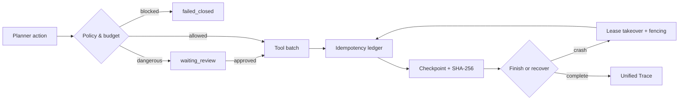

# Agent Runtime & Evaluation Platform

[](https://github.com/KristenYue/agent-runtime-quality-platform/actions/workflows/ci.yml)

> 面向工具型 Agent 的可恢复执行内核与质量门禁：把“任务完成”拆成可检查的状态、工具调用、审批、错误、延迟和成本证据。

## Engineering snapshot

| 验收维度 | 可执行结果 | 代码证据 |
|---|---:|---|
| 功能契约 | **180 / 180** | 自动执行、畸形动作失败关闭、策略拒绝、人工审批四类 Runtime 路径 |
| 故障处置 | **70 / 70** | 68 个恢复；2 个不安全边界按设计失败关闭；未处置 0 |
| 重复提交 | **60 组，额外最终写入 0** | 业务唯一键 + Runtime 幂等结果账本 |
| 数据库并发 | PostgreSQL 双 Worker 接管通过 | lease、heartbeat、单调 fencing token、陈旧写入拒绝 |

逐 case 的预期状态、实际状态、错误码和 Trace 位于 [`data/evaluation/acceptance_v1/report.json`](data/evaluation/acceptance_v1/report.json)。报告明确区分“成功恢复”和“为避免不确定副作用而安全失败关闭”，避免把异常路径隐藏在总通过率中。

## What is implemented



- provider-neutral Planner Protocol 与同步/异步工具注册；
- `asyncio.gather` 独立工具并发、步骤预算和工具调用预算；
- 工具白名单、危险操作人工审批、`pause_for_review` / `resume`；
- Run / Step / ToolCall / Error 统一 Trace；
- SQLite checkpoint、完整性哈希、执行租约、heartbeat 与确定性幂等键；
- 独立 `runtime_*` PostgreSQL 表、连接池生命周期与 fenced state writes；
- baseline/candidate 成对回归门禁，联合检查成功率、质量、错误、延迟与估算成本；
- 舆情 LangGraph 的薄契约适配器，不复制业务项目代码。

## Reference business integration

[通信网络故障诊断 Agent](https://github.com/KristenYue/telecom-network-incident-agent) 是当前 Runtime 的端到端业务适配：通信仓库负责 FastAPI、Redis Worker、领域工具、根因排序与工单草稿；本仓库负责 checkpoint、lease、fencing token、人工审批、幂等结果账本和统一 Trace。业务仓库通过固定提交依赖 Runtime，避免复制执行内核，也让平台升级能够由领域评测独立验收。

## Findings → fixes → regression evidence

| 发现的问题 | 根因 | 工程处理 | 防回归证据 |
|---|---|---|---|
| 只有工具预算时，Planner 仍可无限循环 | 无工具步骤不消耗调用预算 | 增加独立 step budget | `step_budget_exceeded` 回归用例 |
| Worker 失租后仍可能写入状态 | 仅 heartbeat 检测，缺少写入代际校验 | checkpoint 与 tool ledger 写入绑定 owner + fencing token | 陈旧 token 写入必须抛 `StaleLeaseWriteError` |
| 合法 Worker 因墙钟过期被误判 stale | 写入 SQL 错把 lease 活性当作代际 | fencing 只判断单调 token，heartbeat 单独负责活性 | PostgreSQL 接管与边界契约测试 |
| 已完成工具在恢复后被重复调用 | 恢复路径未优先读取结果账本 | 用确定性 idempotency key 回放已提交 Trace | 崩溃恢复用例断言 `replayed_from_cache` |
| 未知写操作无法安全自动重放 | 外部副作用状态不确定 | 非 replay-safe 操作失败关闭 | 两个明确的恢复失败边界用例 |

完整定位过程见 [`docs/ENGINEERING_LOG.md`](docs/ENGINEERING_LOG.md)，Runtime 与业务 V2 的所有权边界见 [`docs/adr/0001-v2-runtime-integration-boundary.md`](docs/adr/0001-v2-runtime-integration-boundary.md)。

## Reproduce

```powershell
python -m venv .venv
.\.venv\Scripts\python.exe -m pip install -e ".[dev]"
.\.venv\Scripts\python.exe -m pytest -q --basetemp .pytest-tmp
.\.venv\Scripts\python.exe scripts\run_acceptance_benchmark.py
```

真实 PostgreSQL 集成测试由 GitHub Actions 的独立 PostgreSQL 16 job 执行；本地运行需要安装 `.[dev,postgres]` 并设置 `RUNTIME_DATABASE_URL`。

## Repository map

```text
src/agent_runtime_platform/       Runtime、backend、工具策略与评测门禁
tests/                            单元、契约、恢复与 PostgreSQL 集成测试
data/evaluation/acceptance_v1/    逐 case 机器可读验收报告
scripts/                          验收基准入口
docs/                             架构、ADR、来源边界与工程日志
migrations/                       独立 runtime_* PostgreSQL schema
```

## Engineering scope

- SQLite 用于本地可复现验证；PostgreSQL job 证明实现能在真实数据库服务上运行，但不是长期压测。
- 幂等键与 fenced writes 防止已覆盖路径的重复提交和陈旧写入，不构成跨任意外部系统的 exactly-once 保证。
- 延迟和成本门禁是同环境回归信号，不外推为生产容量或费用承诺。
- 质量结论只适用于仓库中冻结的任务、阈值和版本。

## License

[MIT](LICENSE)
