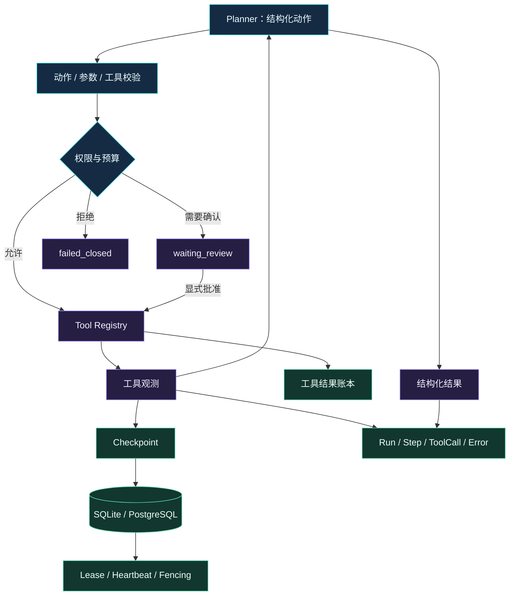
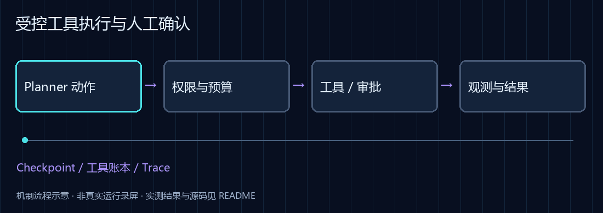
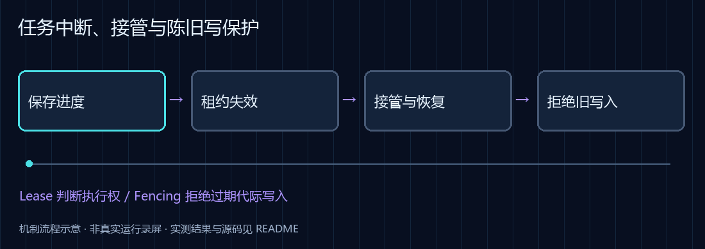
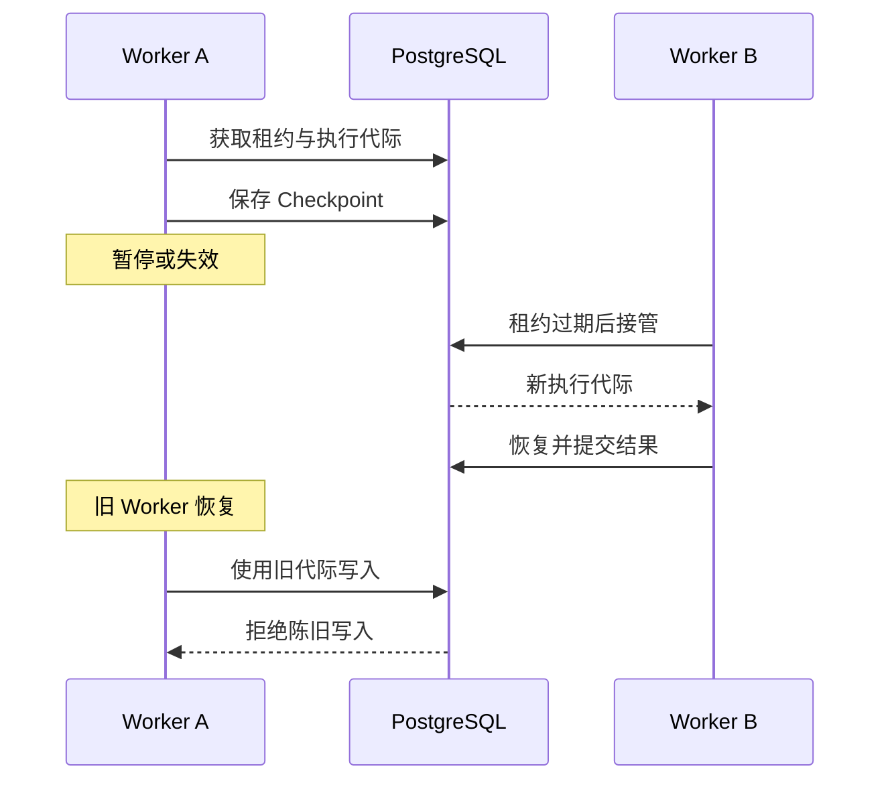

# AI Agent Runtime｜智能任务编排与工具执行引擎

**Python · Planner Protocol · Tool Registry · Checkpoint · PostgreSQL · Lease / Heartbeat / Fencing**

[](https://github.com/KristenYue/agent-runtime-quality-platform/actions/workflows/ci.yml)

[个人技术作品集](https://github.com/KristenYue) · [工业 Agent 与设备应用](https://github.com/KristenYue/telecom-network-incident-agent) · [架构设计](docs/ARCHITECTURE.md)

为工具型 AI 应用提供可复用的执行内核：接收 Planner 的结构化动作，完成工具校验、预算与权限检查、人工确认、执行记录、Checkpoint 和中断恢复。

**业务层负责“完成什么任务”，Runtime 负责“动作如何受控执行、进度如何保存、异常后如何继续”。**

---

## 在整个项目体系中的位置

| 阅读方向 | 本仓库提供的能力 | 对应业务入口 |
|---|---|---|
| **机器人 AI 应用 / 任务平台** | 工具契约、规划循环、观测上下文、Checkpoint 与执行记录 | [机器人技能与任务](https://github.com/KristenYue/telecom-network-incident-agent/blob/main/docs/ROBOT_DELIVERY.md) |
| **半导体 / AI 芯片应用与研发工具** | 设备工具编排、调用预算、知识结果入 Trace、异常终止 | [设备与原生知识诊断](https://github.com/KristenYue/telecom-network-incident-agent) |
| **智能汽车 / 智能终端服务** | 写操作审批、上下文恢复、工具账本与结果提交 | [车辆 Agent](https://github.com/KristenYue/telecom-network-incident-agent/blob/main/docs/VEHICLE_ADAPTER.md) |
| **应用后端 / 软件平台** | 持久化、执行权、幂等、故障恢复与统一数据契约 | 本页及 [PostgreSQL 后端](docs/POSTGRES_BACKEND.md) |

设备协议、机器人反馈与取消、车辆状态事务分别由业务 Adapter 实现；本仓库集中维护通用执行语义。

---

## 核心结果一览

| 验证对象 | 量化结果 | 工程含义 |
|---|---|---|
| **功能契约** | **180 / 180** 满足预期 | 工具调用、执行状态、审批与结果契约一致 |
| **故障处置** | **70 / 70** 按预期处理 | **68 次恢复、2 次失败关闭**，区分恢复与安全终止 |
| **重复提交** | **60 组**，额外最终写入 **0** | 已登记调用与最终结果提交具有明确幂等约束 |
| **真实基础服务集成** | PostgreSQL 接管、Redis Pending 回收与 Compose 启动通过 | 在业务集成路径验证真实数据库、队列和容器环境 |

[逐 case 原始报告](data/evaluation/acceptance_v1/report.json) · [真实服务云端验收](https://github.com/KristenYue/telecom-network-incident-agent/actions/runs/44509829892)

前三项来自冻结的确定性合成契约实验。真实 PostgreSQL / Redis 集成在业务仓库独立验收，两类结果分别记录。

---

## 为什么需要独立执行内核

模型输出工具调用后，软件仍需要处理一系列确定性问题：

- 工具是否存在，参数和权限是否满足要求？
- 当前步骤是否超出预算，是否必须人工确认？
- 工具完成后，结果和上下文保存在哪里？
- Worker 中断后，哪些工作可以复用，哪些动作不能重放？
- 租约过期后旧 Worker 恢复，是否还允许写入？
- 消息再次投递时，怎样避免额外结果提交？

本项目将这些机制从具体业务中抽离，避免每个 Agent 应用重复实现。

---

## 系统架构



---

## 场景一：工具执行、预算与人工确认



> 执行机制示意动画，非实际运行录屏；契约结果与业务轨迹见下方链接。

### 执行流程

```text
Planner 返回动作
  → 校验工具与参数
  → 检查预算及权限
  → 必要时保存待审批上下文
  → 执行工具
  → 保存观测与 Checkpoint
  → 继续规划或提交结果
```

### 核心设计

| 工程问题 | 实现机制 | 设计价值 |
|---|---|---|
| **模型供应商变化** | Provider-neutral Planner Protocol | 模型接入与执行机制解耦 |
| **工具能力变化** | 显式注册、权限与执行上下文 | 开放能力可以核查，业务工具独立演进 |
| **无效循环** | 步骤与工具调用预算 | 将资源上限落实到代码 |
| **危险动作** | 保存待确认动作，批准后恢复 | 模型建议与执行许可分离 |
| **执行过程不可解释** | 统一 Run / Step / ToolCall / Error | 从最终结果反查动作、参数、观测与错误 |

Planner 接收请求、已有观测和步骤信息，输出结构化动作。Runtime 根据契约执行，不将模型返回直接视为系统授权。

### 业务落点

车辆演示中，模拟空调写请求先进入 `waiting_review`。演示程序显式批准后，Runtime 恢复执行并记录结果。

机器人与设备应用将技能或查询工具注册到相同执行机制；传输和设备领域规则保留在业务侧。

[车辆审批轨迹](https://github.com/KristenYue/telecom-network-incident-agent/blob/main/docs/evidence/vehicle-live.json) · [工具注册源码](src/agent_runtime_platform/tools.py)

---

## 场景二：任务中断、接管与陈旧写入保护



> 动画展示恢复机制的责任边界。租约判断执行权，Fencing 约束陈旧执行者的后续写入。

### 为什么只有重试不够

任务中断可能发生在不同位置：

| 中断位置 | 风险 | 处理原则 |
|---|---|---|
| 工具调用前 | 任务尚未推进 | 根据持久化状态继续 |
| 工具完成且结果已记录 | 再执行可能产生重复动作 | 复用已登记结果 |
| 外部动作可能完成，但结果未知 | 重放可能重复产生副作用 | 按重放安全性判断，必要时失败关闭 |
| 旧 Worker 暂停后恢复 | 可能覆盖新执行者结果 | 使用 Fencing 拒绝陈旧代际写入 |

### 三个机制分别负责什么

**Checkpoint：保存执行进度。**  
记录步骤、观测、待审批动作及上下文，恢复时不只依赖进程内存。

**工具账本：保存可识别的调用结果。**  
依据已登记的调用身份复用完成结果，并结合 replay-safe 信息判断是否允许重放。

**Lease / Heartbeat / Fencing：管理有效执行权。**  
租约与心跳用于判断执行者是否失效；接管产生新的执行代际，持久化写入拒绝过期 Fencing Token。



[PostgreSQL 实现](src/agent_runtime_platform/postgres.py) · [后端设计](docs/POSTGRES_BACKEND.md)

### 与消息队列的协作

在业务部署中，Redis Streams 负责投递与 Pending 回收，Runtime 负责执行上下文、工具账本和结果提交约束。

业务完成后再确认消息；落库后、确认前中断会产生可识别的再次投递。系统按 **at-least-once** 语义设计，不依赖消息只出现一次的假设。

[业务可靠任务设计](https://github.com/KristenYue/telecom-network-incident-agent/blob/main/docs/RELIABLE_JOBS.md)

---

## 核心模块与源码

| 模块 | 完成的工作 | 入口 |
|---|---|---|
| **Planner / 动作契约** | 请求、观测、步骤、动作与结果数据结构 | [contracts.py](src/agent_runtime_platform/contracts.py) |
| **工具注册与权限** | 同步 / 异步工具、权限、上下文与调用边界 | [tools.py](src/agent_runtime_platform/tools.py) |
| **执行循环** | 预算、工具调用、审批、观测与结果流转 | [runtime.py](src/agent_runtime_platform/runtime.py) |
| **PostgreSQL 后端** | Checkpoint、租约、接管与陈旧写入保护 | [postgres.py](src/agent_runtime_platform/postgres.py) |
| **架构与业务边界** | 内核与业务 Adapter 的职责划分 | [ARCHITECTURE.md](docs/ARCHITECTURE.md) |
| **逐项验收** | 功能、故障与重复提交结果 | [report.json](data/evaluation/acceptance_v1/report.json) |

---

## 如何验证结果

### 本地运行

```bash
python -m venv .venv

# Windows:
# .venv\Scripts\activate

# Linux:
# source .venv/bin/activate

python -m pip install -e '.[dev]'

python scripts/run_acceptance_benchmark.py
python -m pytest -q
```

### PostgreSQL 路径

安装对应依赖：

```bash
python -m pip install -e '.[dev,postgres]'
```

通过本机环境变量设置 `RUNTIME_DATABASE_URL`。连接配置与运行说明见 [PostgreSQL 后端](docs/POSTGRES_BACKEND.md)。

### 查看真实业务调用

- [机器人真实模型任务](https://github.com/KristenYue/telecom-network-incident-agent/blob/main/docs/evidence/robot-live.json)
- [设备与原生知识工具联合诊断](https://github.com/KristenYue/telecom-network-incident-agent/blob/main/docs/evidence/native-llm-live.json)
- [车辆审批与服务执行](https://github.com/KristenYue/telecom-network-incident-agent/blob/main/docs/evidence/vehicle-live.json)
- [PostgreSQL / Redis 集成验收](https://github.com/KristenYue/telecom-network-incident-agent/actions/runs/44509829892)

---

## 工程方法与设计取舍

| 问题 | 采用的原则 |
|---|---|
| 业务领域持续变化 | 领域规则留在业务 Adapter，执行机制集中复用 |
| 成功率容易掩盖错误恢复 | 将恢复成功与按预期失败关闭分别统计 |
| 重复消息不可避免 | 使用持久化身份和结果约束处理重投 |
| 心跳不能阻止旧执行者写入 | 将存活判断与 Fencing 写入保护分开 |
| 外部副作用无法确认 | 不用盲目重试换取表面成功 |
| 本地演示与多 Worker 部署不同 | SQLite 与 PostgreSQL 路径分别说明、分别验收 |

[工程日志](docs/ENGINEERING_LOG.md) · [源码责任边界](docs/SOURCE_BOUNDARY.md) · [集成边界 ADR](docs/adr/0001-v2-runtime-integration-boundary.md)

---

<details>
<summary>实验与部署口径</summary>

180 条功能任务、70 次故障处置、60 组重复提交属于冻结的确定性合成契约实验，不代表生产 SLA 或容量。

PostgreSQL 接管与 Redis 回收使用真实服务，在业务集成仓库独立验收。SQLite 用于本地演示，不作为多 Worker 协调成果。

工具账本和幂等键覆盖已登记的调用，不能对任意外部系统提供 exactly-once 保证。未知且不可安全重放的副作用按设计终止。

机器人进度与取消、设备状态守卫、车辆事务由对应业务模块承担，不全部归入 Runtime 内核。

</details>

---

[MIT License](LICENSE)
